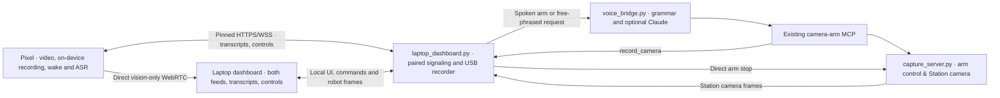
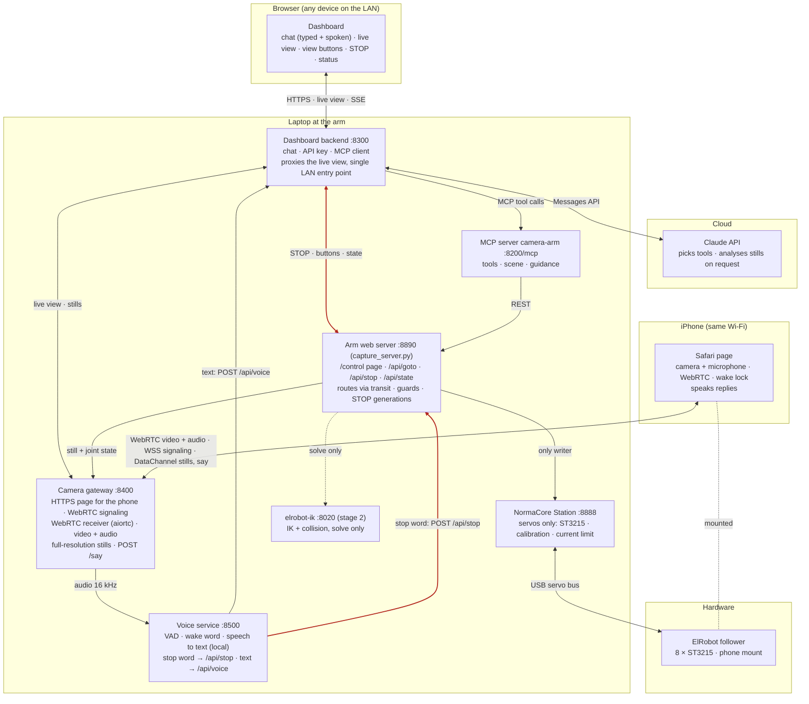
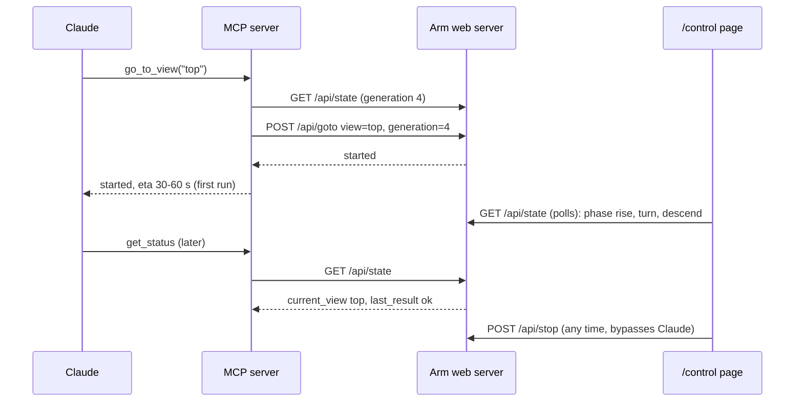
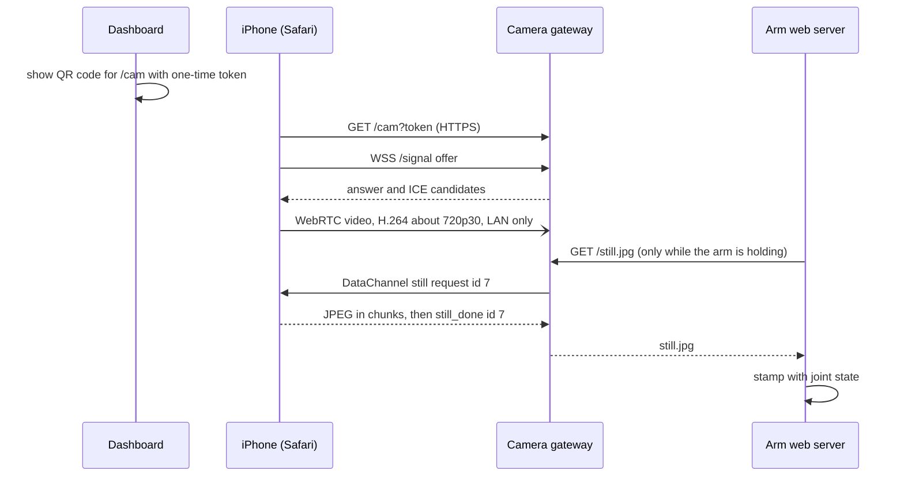
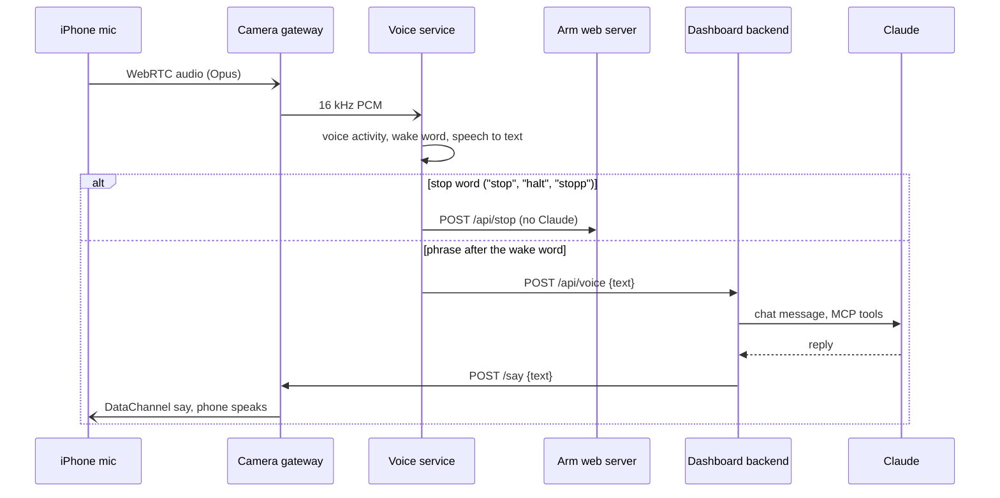

# Architecture — Local Vision dashboard and camera arm

## Current capture and command boundary

The laptop hosts the HackLab operator dashboard on loopback. The app on the Pixel owns capture, the audio/video master, wake detection and offline ASR. The laptop verifies the phone certificate and pairs using the existing approval flow. The phone's vision-only WebRTC feed stays peer-to-peer. Station owns the USB camera and publishes frames through `capture_server.py`.



Phone masters retain native quality and audio. Robot clips are video-only and finalize when their tab loses visibility or its feed stops. Exact recording phrases use the phone's acoustic cross-check. Unqualified start or stop requests target the phone. [Startup, recording and acceptance guide](LAPTOP_DASHBOARD.md)

---

## Historical iPhone gateway proposal

The following 21 November planning notes describe the former Safari gateway and laptop speech service. Keep the arm-control and MCP design references here. The current capture and voice architecture is above.

## Build status

| Part | State | Code | Docs |
|---|---|---|---|
| Arm web server = control service | built by the team, reviewed; **works on the real arm**: 10 supervised moves on 21 Nov (transit, `top`, `wide`, `right`), see [MOTION_PLAN.md](MOTION_PLAN.md#first-real-session-sat-21-nov-1608-1614) | `capture_server.py` (`/control`, `/api/...`), `motion.py`, `fk.py` | [MOTION.md](MOTION.md), [MOTION_PLAN.md](MOTION_PLAN.md) |
| MCP server camera-arm | built, tested against the web server on the simulated arm; not yet with the real arm | `mcp_server.py`, plus `GET /api/still.jpg` in `capture_server.py` | [MCP.md](MCP.md) |
| Phone capture and vision-only WebRTC | implemented on Android | `dashboard/apps/mobile` | [Local Vision status](../dashboard/docs/STATUS.md) |
| Voice capture and transcription | runs on Android | `dashboard/apps/mobile` | [voice pipeline](../dashboard/docs/adr/0004-voice-pipeline.md) |
| Dashboard | browser implements recording intent; arm requests go through `voice_bridge.py` to MCP (tested on the simulated arm) | `dashboard/apps/dashboard`, `voice_bridge.py` | [handoff](../dashboard/docs/ARCHITECTURE.md#dashboard-command-routing-and-mcp-handoff) |
| elrobot-ik (stage 2) | not started | – | this page |
| Framing preview (stage 2) | built, tested on the simulated arm; preview only, never moves; estimates not yet checked on the real arm | `framing.py`, `POST /api/frame` (dry_run), MCP `preview_frame`, `best_view` | [FRAMING.md](FRAMING.md) |

The existing MCP still-image tool continues to use Station’s USB camera or, with `--sim`, the saved snapshot of the simulated view.

## Decisions at a glance

- **No blocking moves.** `POST /api/goto` starts the move as a task and returns at once. Progress and results come from `GET /api/state`.
- **Safety lives in the arm web server.** `capture_server.py` is the one program that moves the arm (route through the transit pose, guards, STOP generations). Dashboard, MCP and later voice are its clients and pass through the same checks.
- **Our own MCP server.** It holds the context (views, scene, guidance) and only forwards moves. NormaCore's `elrobot-ik` example (dev branch) serves internally as a solver from stage 2 on.
- **Stop without Claude.** The stop button goes from the dashboard straight to control and cancels any move in flight.
- **Voice uses the iPhone microphone.** Audio travels with the video to the gateway; speech to text runs on the laptop, only text goes to Claude. A stop word is matched locally and sent to `/api/stop` without Claude.
- **Claude gets stills, people get the live stream.** A full-resolution still from a resting arm is sharper than a video frame, and the arm pose that belongs to it is known.

## Layers



The red links are the stop paths that do not go through Claude or the MCP server: the dashboard's STOP and view buttons, and a spoken stop word.

## Where each part runs

Everything runs on the laptop the follower is plugged into. Only the dashboard backend (8300) and the phone page of the camera gateway (8400) are reachable from the LAN; everything else listens on localhost.

| Part | Port | Reachable from | Basis in this repo |
|---|---|---|---|
| Dashboard (UI) | – | any browser | new |
| Dashboard backend | 8300 | LAN, with token | `director.py` (Claude loop) |
| Voice service | 8500 | localhost | new |
| MCP server camera-arm | 8200 | localhost | new |
| Camera gateway | 8400 | LAN (phone page only), rest localhost | new |
| elrobot-ik (stage 2) | 8020 | localhost | NormaCore dev, example |
| Station | 8888 / 8889 | localhost | v0.1.0-beta.10 |
| Arm web server (capture, `/control`, `/api`) | 8890 (`--sim`: 8891) | localhost | `capture_server.py`, `motion.py` |

## Where each piece of information lives

| Information | Owner | Storage | Read by |
|---|---|---|---|
| Views: joint values, transit pose, checked flag | Arm web server | `views.json` | web server only (whitelist) |
| Views: name, description, aliases, snapshot | Arm web server | `views.json`, `views/*.jpg` | MCP, dashboard |
| Scene: objects, position in image per view, later on the table | MCP | `scene.json` | Claude, dashboard (overlay) |
| Motion state, phase, current view, blockers | Arm web server | memory | everyone via `GET /api/state` |
| Calibration, joint ranges, current limit | Station | Station config | Arm web server |
| Live video, latest frame | Camera gateway | memory | dashboard backend |
| Stills with view and joint state | Arm web server (`/api/still.jpg`, later from the gateway) | memory | MCP, dashboard backend |
| Chat history, API key | Dashboard backend | memory, environment variable | backend only |
| Event log (overlay, demo) | director / backend; move log in `motion_log.jsonl` | files | dashboard, analysis |
| Guidance for Claude | MCP | resource `camera-arm://guide` | Claude |
| Audio from the iPhone | Camera gateway → voice service | memory only, never stored | voice service |
| Transcripts | Voice service | `events.jsonl` (`heard`) | dashboard backend, overlay |

## Moving without blocking

The web server starts each move as its own asyncio task (`State.start_move`) and answers at once. Only one command owns the arm at a time; STOP never queues, and every actuating request carries the `generation` it saw in `/api/state`, so a request from before a STOP can never start after it. Moves go rise → turn → descend through the taught `transit` pose; views nobody has checked on the real arm run at first-run speed. Details: [MOTION.md](MOTION.md).



## How the phone connects



## Voice path



| Rule | Why |
|---|---|
| A stop word is matched locally and sent to `/api/stop` at once, also without wake word | Stop must not wait for Claude or the cloud, and must work while Claude or the backend hang |
| Everything else needs the wake word ("camera, show me the board from above") | The person talks while working; only addressed phrases should move the arm |
| While the arm moves, only stop words are acted on | Servo noise and reactions to the move would produce stray commands |
| The microphone is ignored while the phone speaks | Otherwise the phone hears its own reply |
| Speech to text runs on the laptop; only text goes to Claude | No audio leaves the room; lower latency |
| Each step goes to `events.jsonl` as `heard`, `decided`, `moved`, `reply` | Same format as `director.py`, for the overlay and the demo video |

## What the MCP server knows

View, from `list_views`:

```json
{
  "name": "top",
  "description": "Straight above the work area, whole PCB in frame",
  "aliases": ["from above", "top-down"],
  "snapshot": "views/top.jpg",
  "shows": ["pcb", "soldering_iron"]
}
```

Object in the scene. The image position is normalized to 0–1 per view and camera. `world` stays `null` until stage 2, then `{x, y, z, w, d, h}` in meters, origin on the base rotation axis at table height (as in elrobot-ik).

```json
{
  "id": "pcb",
  "label": "Circuit board",
  "description": "green PCB, about 10 x 8 cm",
  "seen": [{
    "view": "top", "camera": "iphone",
    "at": "2026-11-21T15:02:10Z",
    "bbox": {"cx": 0.52, "cy": 0.47, "w": 0.38, "h": 0.30},
    "visible": 0.9
  }],
  "world": null,
  "source": "claude-vision"
}
```

## Interfaces

### MCP server camera-arm (for Claude)

| Tool / resource | Returns | Stage |
|---|---|---|
| `list_views()` | name, description, aliases, what each view shows | 1 |
| `go_to_view(name)` | immediately: `started`, `eta_hint`; `name` is a fixed enum (no `transit`) | 1 |
| `get_status()` | moving, target view, phase, progress, current view, blockers, last result | 1 |
| `stop()` | holds immediately | 1 |
| `get_camera_image()` | still as JPEG + `view`; refused while the arm moves | 1 |
| `get_scene()` | all objects with image position, age, visibility | 1 |
| `update_scene(objects, replace?)` | stores Claude's image analysis, merged by object id and view; schema validated (bbox 0..1, known views, id pattern) | 1 |
| `remove_scene_object(id)` | drops an object that is gone | 1 |
| `best_view(object_id, move?)` | saved view that showed the object best (large, centred, visible, recent); moves there. **Built** | 2 |
| `preview_frame(object_id, framing?)` | **preview only**: where the camera would go to frame the object, and whether the checks pass. **Built**, see [FRAMING.md](FRAMING.md) | 2 |
| `frame_object(object_id, framing?)` | the same as a real move (stage C, not built) | 2 |
| `camera-arm://guide` | rules, reference frames, meaning of states | 1 |
| `camera-arm://scene` | the recorded scene as JSON | 1 |

Claude gets no free joint or Cartesian moves. Built: everything marked stage 1 (`mcp_server.py`, Streamable HTTP on `127.0.0.1:8200/mcp`, official `mcp` SDK 2.3). Refusals from the web server reach Claude as tool errors with its readable text (`busy`, `refused`, `unavailable`, `arm_server_unreachable`, ...). Details: [MCP.md](MCP.md).

### Arm web server (`capture_server.py`, localhost only)

The team's server is the control service. The calls the MCP server and a dashboard use:

| Call | Response |
|---|---|
| `GET /api/state` | `generation`, `motion` (moving, view, phase, progress, error, last_result), `current_view`, `can_move`, `blockers`, `cards` (views with `checked`), `hold`, `stopping` |
| `POST /api/goto {"view", "generation"}` | starts the move as a task: `{ok, started, view, speed}`; 409 with a readable reason when refused (moving, stale generation, unknown pose, limp ...) |
| `POST /api/stop` | always answers: `{ok, hold: confirmed\|unconfirmed, was_moving, view}` |
| `GET /api/still.jpg` | one JPEG while nothing moves, headers `X-View`, `X-Joints`, `X-Taken-At`; 409 while moving, 503 without a fresh frame. Added for the MCP server, read-only |
| `GET /stream` | live MJPEG from Station's camera |
| `GET /control` | operator page: click a view, STOP always visible (also Space/Esc) |

`go.py` and `director.py` can still move the arm directly, but the README rule is one controlling program per session: the web server.

### Camera gateway

| Call | Purpose |
|---|---|
| `GET /cam?token=…` | the phone page (HTML + JS), HTTPS only |
| `WSS /signal` | SDP offer/answer and ICE candidates, one phone at a time |
| `GET /status` | `{connected, width, height, fps, frame_age_ms, orientation, page_visible}` |
| `GET /live.mjpeg` | live view for the dashboard backend (localhost only) |
| `GET /still.jpg` | full-resolution still from the phone; `503 no_phone`, `504 timeout` |
| `GET /events` | SSE: phone connected / lost, page hidden, resolution changed |
| `POST /say {text}` | the phone speaks the text (DataChannel → `speechSynthesis`); the voice pipeline ignores the microphone meanwhile |
| audio → voice service | 16 kHz mono PCM over a local socket |

### Voice service

| Call | Purpose |
|---|---|
| `GET /status` | `{listening, muted, wake_word, last_heard, model}` |
| `GET /events` | SSE: `heard` (with text), `stop`, `ignored` (no wake word, or arm moving) |
| `POST /mute {on}` | push-to-talk or mute from the dashboard |
| calls out | `POST /api/stop` on the web server for stop words, `POST /api/voice {text}` on the backend for everything else |

DataChannel messages from the phone: `{"type":"status","orientation":"landscape","visible":true}` every second, and stills as binary chunks closed by `{"type":"still_done","id":7}`. If the status stops, the gateway reports the camera as lost; the arm keeps working without images.

### Dashboard backend

| Call | Effect |
|---|---|
| `POST /api/chat {text}` | message to Claude, reply streamed; Claude uses the MCP tools |
| `POST /api/voice {text}` | the same for spoken text (from the voice service); the reply also goes to the phone via the gateway's `POST /say` |
| `POST /api/context` | still via MCP `get_camera_image`, sent to Claude with "describe the scene"; Claude writes via `update_scene` |
| `POST /api/stop` | straight to control, bypassing Claude |
| `POST /api/views/{name}` | dashboard button, straight to control |
| `GET /api/live` | live view proxied from the gateway |
| `GET /api/events` | SSE from control, gateway and chat for status and overlay |

The backend is the MCP client: it fetches the tool list from the MCP server and hands it to Claude as tools. The Claude API's MCP connector would need a publicly reachable address, which we do not want.

## What to check before building

**Hardware (first)**
- Payload: can the ElRobot wrist carry 170–230 g plus mount? Watch the current limit (`current-threshold: 100` in `config/station.yaml`), lower the speed, retune the arrival tolerance.
- A mount that holds the phone firmly and leaves the rear lenses free.
- Charging cable along the arm, or check that the battery lasts the demo.
- Re-capture all views, since the camera position changes.

**iPhone and Safari**
- Camera access needs HTTPS with a certificate the iPhone trusts (for example a local CA installed as a profile).
- The camera stops when the screen locks or Safari goes to the background: turn off Auto-Lock, use the Wake Lock API, Guided Access keeps the page in front.
- Lens choice (wide or ultra-wide) and zoom through constraints: test what Safari supports.
- Heat: a phone streaming for hours can throttle.

**Voice**
- Servo noise next to the phone's microphone: record phrases during a move and test recognition.
- Distance: the phone moves with the arm, sometimes 50 cm or more from the speaker.
- Speech to text on the laptop CPU: latency of a small multilingual model for German and English.
- False wake words while people talk at the desk; push-to-talk in the dashboard as fallback.
- Safari plays the spoken reply only after one tap on the phone page.

**Network**
- Hackathon Wi-Fi often isolates clients or blocks UDP. Plan B: laptop hotspot, or the laptop joins the phone's hotspot.
- Safari hides local IPs behind `.local` names until camera access is granted; confirm the ICE candidates reach the gateway.

**Software**
- Dependencies: `mcp` is approved and in `pyproject.toml` (MCP server only). Everything that moves the arm stays standard library. Still to agree on: `aiortc` (gateway, pulls in `av`); a speech-to-text library (e.g. `faster-whisper`), voice activity detection and possibly a wake-word model (voice service); `fastapi`/`uvicorn` for backend and gateway only if the standard library gets too painful.
- Video recording for datasets, if needed, moves from Station into the gateway.

**Cheaper alternative to test first**
- With Continuity Camera the iPhone shows up as a regular camera on macOS. If Station's `usb-video` driver sees it, the existing camera path works unchanged, with no WebRTC. Worth a 10-minute test before building the gateway.

## Still missing for stage 1

Done:
- Non-blocking moves, one command owner, STOP generations, routes through the transit pose, guards (team, `capture_server.py` + `motion.py`, tested on the sim).
- Geometry model of the arm and stick-figure view (`fk.py`, `arm_view.py`).
- MCP server with views, moves, status, stop, image and scene tools, against the web server's `/api` (`mcp_server.py`, `tests/test_mcp_sim.py`).

Open:
- Rest of the real-arm protocol (team): Stop test, block test, `left`, `close`, `side_low`, `home`, normal speed, then mark views as checked ([MOTION_PLAN.md](MOTION_PLAN.md)).
- First MCP session on the real arm: `list_views`, `go_to_view` to a checked view, `stop`, `get_camera_image` with Station's USB camera.
- Re-capture `home`, `left`, `right`, `side_low` off the joint limits, with a level horizon.
- Dashboard: chat, live view, view buttons, big stop button, status.
- Camera gateway for the iPhone (video + audio), with tests on a fake phone.
- Voice service: stop word path first, then wake word and speech to text.

## Open decisions

- May Claude move the arm directly, or does the user confirm in the dashboard? Proposal for stage 1: directly, since only checked views are reachable.
- Who maintains the scene: only Claude via `update_scene`, or can the user correct it in the dashboard?
- Dashboard access on the LAN: is a token enough for the hackathon?

## Safety

The arm moves next to human hands and a hot soldering iron, now with a phone high up on the wrist. No path to the arm may bypass control, and stop must work even when Claude, the MCP server or the gateway hangs. First moves with the phone mounted: half speed, one person at the power switch, a hand ready to catch the phone.
