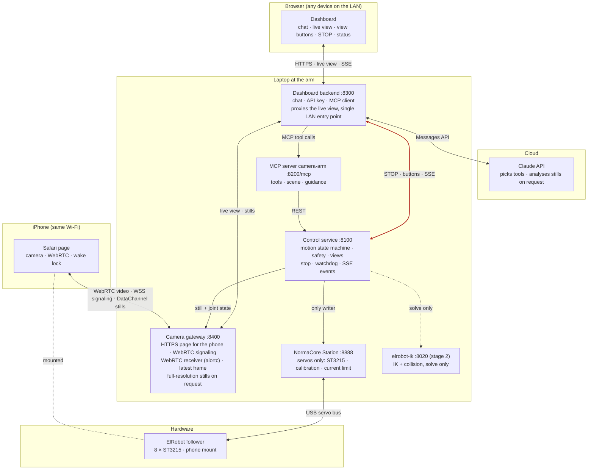
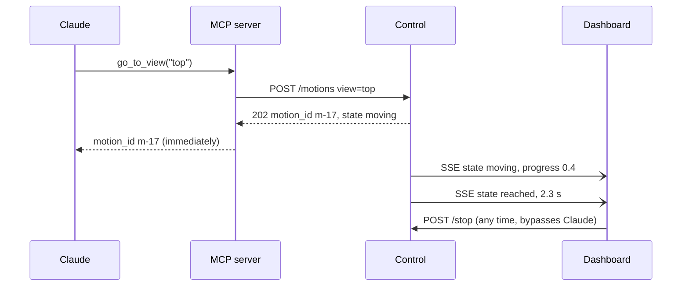
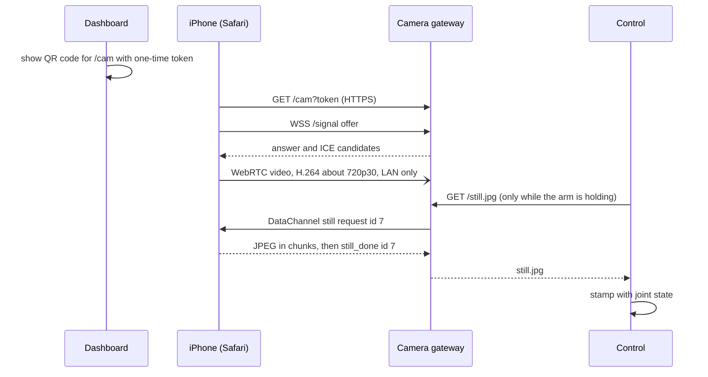

# Architecture: camera arm with an iPhone camera

Proposal, 21 Nov 2026. An iPhone on the follower's gripper is the camera. A Safari page on the phone streams video over WebRTC to a camera gateway on the laptop. People control the arm from a dashboard with a chat; Claude picks positions through our own MCP server. Station only drives the servos.

## Decisions at a glance

- **No blocking moves.** A move request returns at once with a `motion_id`. Progress comes from status queries and an SSE event stream.
- **Safety lives in the control service.** It is the only writer to Station. Dashboard, MCP, CLI and later voice all pass through the same checks.
- **Our own MCP server.** It holds the context (views, scene, guidance) and only forwards moves. NormaCore's `elrobot-ik` example (dev branch) serves internally as a solver from stage 2 on.
- **Stop without Claude.** The stop button goes from the dashboard straight to control and cancels any move in flight.
- **Claude gets stills, people get the live stream.** A full-resolution still from a resting arm is sharper than a video frame, and the arm pose that belongs to it is known.

## Layers



The red link is the direct path for stop, view buttons and events. It does not go through Claude or the MCP server.

## Where each part runs

Everything runs on the laptop the follower is plugged into. Only the dashboard backend (8300) and the phone page of the camera gateway (8400) are reachable from the LAN; everything else listens on localhost.

| Part | Port | Reachable from | Basis in this repo |
|---|---|---|---|
| Dashboard (UI) | – | any browser | new |
| Dashboard backend | 8300 | LAN, with token | `director.py` (Claude loop) |
| MCP server camera-arm | 8200 | localhost | new |
| Camera gateway | 8400 | LAN (phone page only), rest localhost | new |
| Control service | 8100 | localhost | `motion.py`, `station_arm.py` |
| elrobot-ik (stage 2) | 8020 | localhost | NormaCore dev, example |
| Station | 8888 / 8889 | localhost | v0.1.0-beta.10 |
| Capture UI (record views) | 8890 | localhost | `capture_server.py` |

## Where each piece of information lives

| Information | Owner | Storage | Read by |
|---|---|---|---|
| Views: joint values, via paths, speed | Control | `views.json` | control only (whitelist) |
| Views: name, description, aliases, snapshot | Control | `views.json`, `views/*.jpg` | MCP, dashboard |
| Scene: objects, position in image per view, later on the table | MCP | `scene.json` | Claude, dashboard (overlay) |
| Motion state, current joints, nearest view | Control | memory | everyone via `/status` and events |
| Calibration, joint ranges, current limit | Station | Station config | Control |
| Live video, latest frame | Camera gateway | memory | dashboard backend |
| Stills with joint state | Control (from the gateway) | memory, optionally `stills/` | MCP, dashboard backend |
| Chat history, API key | Dashboard backend | memory, environment variable | backend only |
| Event log (overlay, demo) | Control and backend | `events.jsonl` | dashboard, analysis |
| Guidance for Claude | MCP | resource `camera-arm://guide` | Claude |

## Moving without blocking

Control runs each move as its own asyncio task (`motion.move_to` already holds on cancel) and streams waypoints at 30 Hz. A second request during a move is rejected with `409 busy`; only stop cancels.

```
idle → go_to_view → moving → reached | stalled | timeout | stopped → holding
```



## How the phone connects



## What the MCP server knows

View, from `list_views`:

```json
{
  "name": "top",
  "description": "Straight above the work area, whole PCB in frame",
  "aliases": ["from above", "top-down"],
  "snapshot": "views/top.jpg",
  "shows": ["pcb", "soldering_iron"]
}
```

Object in the scene. The image position is normalized to 0–1 per view and camera. `world` stays `null` until stage 2, then `{x, y, z, w, d, h}` in meters, origin on the base rotation axis at table height (as in elrobot-ik).

```json
{
  "id": "pcb",
  "label": "Circuit board",
  "description": "green PCB, about 10 x 8 cm",
  "seen": [{
    "view": "top", "camera": "iphone",
    "at": "2026-11-21T15:02:10Z",
    "bbox": {"cx": 0.52, "cy": 0.47, "w": 0.38, "h": 0.30},
    "visible": 0.9
  }],
  "world": null,
  "source": "claude-vision"
}
```

## Interfaces

### MCP server camera-arm (for Claude)

| Tool / resource | Returns | Stage |
|---|---|---|
| `list_views()` | name, description, aliases, what each view shows | 1 |
| `go_to_view(name)` | immediately: `motion_id`, state; `name` is a fixed enum | 1 |
| `get_status(motion_id?)` | state, progress, nearest view, last error | 1 |
| `stop()` | holds immediately | 1 |
| `get_camera_image()` | latest still with joint state | 1 |
| `get_scene()` | all objects with image position, age, visibility | 1 |
| `update_scene(objects)` | stores Claude's image analysis, schema validated | 1 |
| `frame_object(id, framing)` | immediately: `motion_id`, or `unreachable` / `collision` | 2 |
| `best_view(id)` | view where the object is least occluded | 3 |
| `camera-arm://guide` | rules, reference frames, meaning of states | 1 |

Claude gets no free joint or Cartesian moves.

### Control service (REST, localhost only)

| Call | Response |
|---|---|
| `GET /health` | Station connected, age of motor data, control authority (mirroring active?), camera gateway connected |
| `GET /status` | `{state, motion_id, view, nearest_view, progress, joints, error}` |
| `GET /views` | views without joint values |
| `POST /motions {"view"}` | `202` with `motion_id` · `404 unknown_view` · `409 busy` · `409 not_ready` |
| `POST /motions {"frame"}` | stage 2: target from object position, `422 unreachable / collision` |
| `GET /motions/{id}` | `moving · reached · stalled · timeout · stopped · error`, duration, max error |
| `POST /stop` | always `200`, goal = current position |
| `GET /still.jpg` | still from the gateway, only while holding; joint state in a header |
| `GET /events` | SSE, one JSON object per state change (`curl -N localhost:8100/events`) |

A small CLI (`ctl.py go top`, `ctl.py stop`, `ctl.py status`, `ctl.py watch`) calls the same REST API. `go.py` becomes a client of the service so that only one process writes to Station.

### Camera gateway

| Call | Purpose |
|---|---|
| `GET /cam?token=…` | the phone page (HTML + JS), HTTPS only |
| `WSS /signal` | SDP offer/answer and ICE candidates, one phone at a time |
| `GET /status` | `{connected, width, height, fps, frame_age_ms, orientation, page_visible}` |
| `GET /live.mjpeg` | live view for the dashboard backend (localhost only) |
| `GET /still.jpg` | full-resolution still from the phone; `503 no_phone`, `504 timeout` |
| `GET /events` | SSE: phone connected / lost, page hidden, resolution changed |

DataChannel messages from the phone: `{"type":"status","orientation":"landscape","visible":true}` every second, and stills as binary chunks closed by `{"type":"still_done","id":7}`. If the status stops, the gateway reports the camera as lost; the arm keeps working without images.

### Dashboard backend

| Call | Effect |
|---|---|
| `POST /api/chat {text}` | message to Claude, reply streamed; Claude uses the MCP tools |
| `POST /api/context` | still via MCP `get_camera_image`, sent to Claude with "describe the scene"; Claude writes via `update_scene` |
| `POST /api/stop` | straight to control, bypassing Claude |
| `POST /api/views/{name}` | dashboard button, straight to control |
| `GET /api/live` | live view proxied from the gateway |
| `GET /api/events` | SSE from control, gateway and chat for status and overlay |

The backend is the MCP client: it fetches the tool list from the MCP server and hands it to Claude as tools. The Claude API's MCP connector would need a publicly reachable address, which we do not want.

## What to check before building

**Hardware (first)**
- Payload: can the ElRobot wrist carry 170–230 g plus mount? Watch the current limit (`current-threshold: 100` in `config/station.yaml`), lower the speed, retune the arrival tolerance.
- A mount that holds the phone firmly and leaves the rear lenses free.
- Charging cable along the arm, or check that the battery lasts the demo.
- Re-capture all views, since the camera position changes.

**iPhone and Safari**
- Camera access needs HTTPS with a certificate the iPhone trusts (for example a local CA installed as a profile).
- The camera stops when the screen locks or Safari goes to the background: turn off Auto-Lock, use the Wake Lock API, Guided Access keeps the page in front.
- Lens choice (wide or ultra-wide) and zoom through constraints: test what Safari supports.
- Heat: a phone streaming for hours can throttle.

**Network**
- Hackathon Wi-Fi often isolates clients or blocks UDP. Plan B: laptop hotspot, or the laptop joins the phone's hotspot.
- Safari hides local IPs behind `.local` names until camera access is granted; confirm the ICE candidates reach the gateway.

**Software**
- New dependencies to agree on: `aiortc` (gateway, pulls in `av`), `fastapi`/`uvicorn` (control, backend, gateway), `mcp` (MCP server).
- Video recording for datasets, if needed, moves from Station into the gateway.

**Cheaper alternative to test first**
- With Continuity Camera the iPhone shows up as a regular camera on macOS. If Station's `usb-video` driver sees it, the existing camera path works unchanged, with no WebRTC. Worth a 10-minute test before building the gateway.

## Still missing for stage 1

- Non-blocking `motion.py`: move task with ID, states and events (today `go_to_view` waits until the end).
- First run on the real arm (so far only on the simulator): half speed, one person at the power switch.
- Safe paths between views: `via` poses through `home` or a high intermediate pose, joints one after another.
- Detect active leader mirroring and reject with `409 not_ready` (Station does not arbitrate control authority yet, see NormaCore ADR 0009).
- Watchdog: motor data older than 0.5 s or Station gone → cancel the move, hold.
- Dashboard: chat, live view, view buttons, big stop button, status.
- Hardware-free tests for control, MCP and gateway on `sim_arm.py` and a fake phone.

## Open decisions

- May Claude move the arm directly, or does the user confirm in the dashboard? Proposal for stage 1: directly, since only checked views are reachable.
- Who maintains the scene: only Claude via `update_scene`, or can the user correct it in the dashboard?
- Dashboard access on the LAN: is a token enough for the hackathon?

## Safety

The arm moves next to human hands and a hot soldering iron, now with a phone high up on the wrist. No path to the arm may bypass control, and stop must work even when Claude, the MCP server or the gateway hangs. First moves with the phone mounted: half speed, one person at the power switch, a hand ready to catch the phone.
